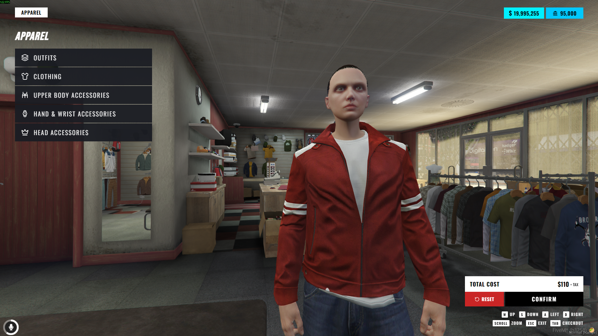
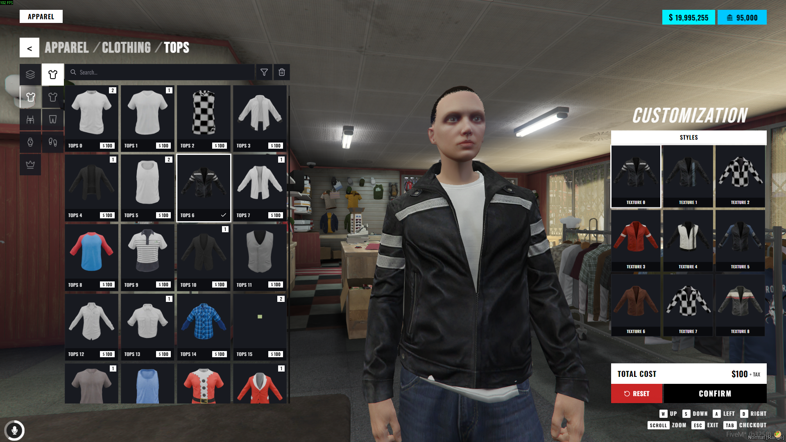
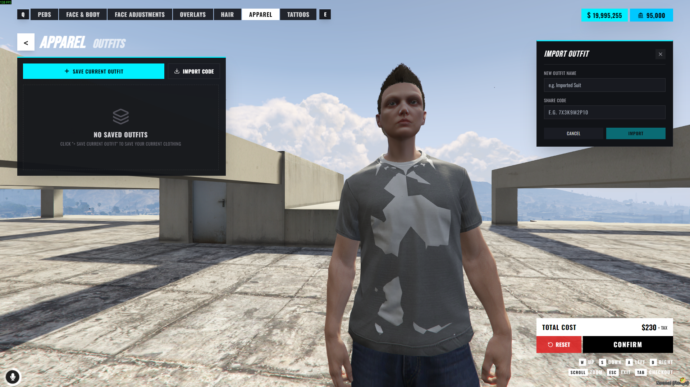
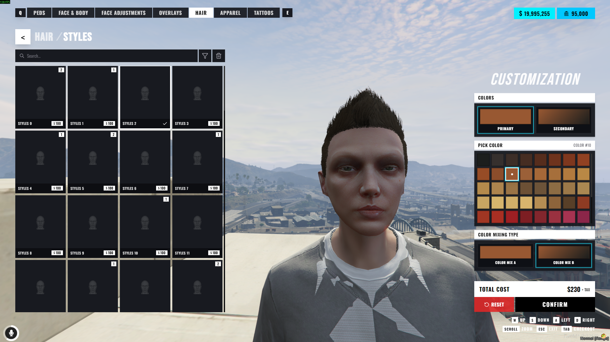
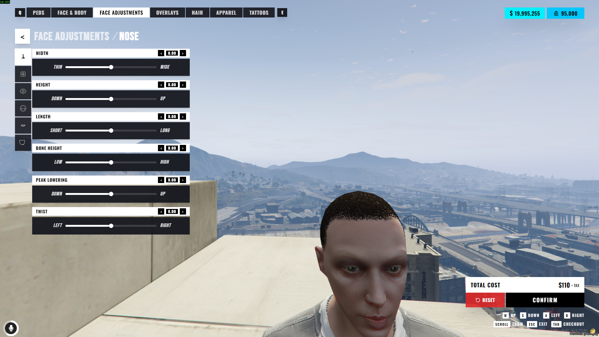
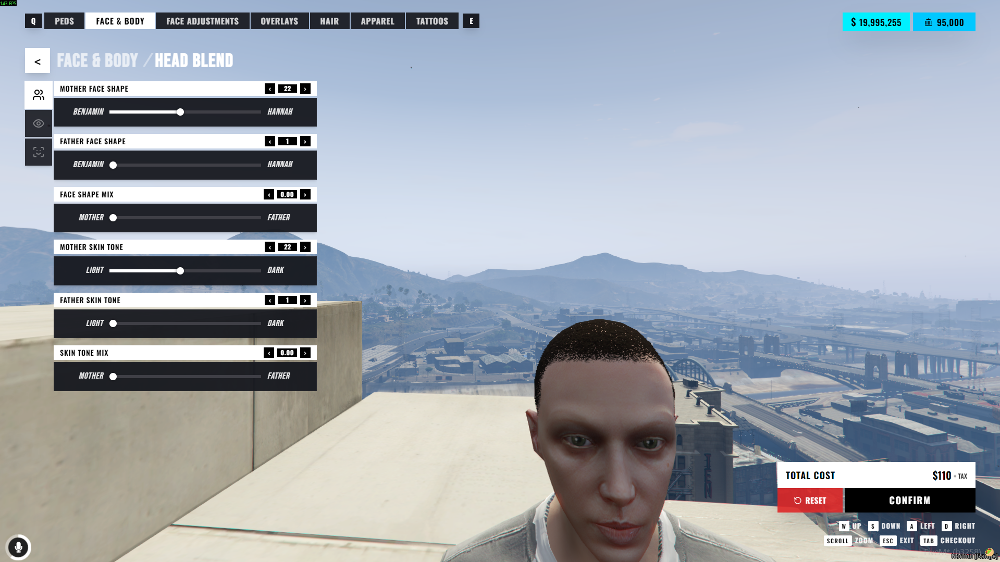
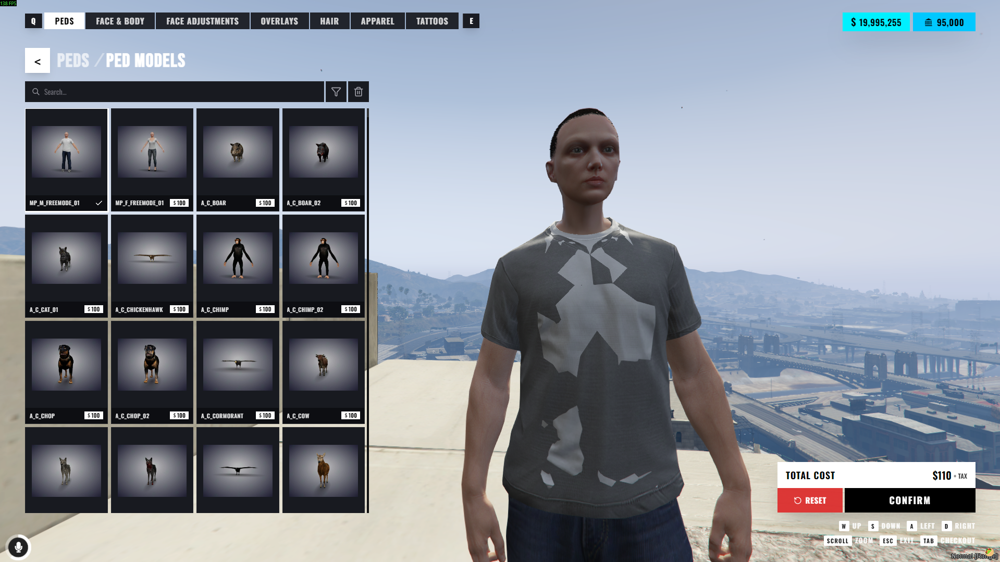
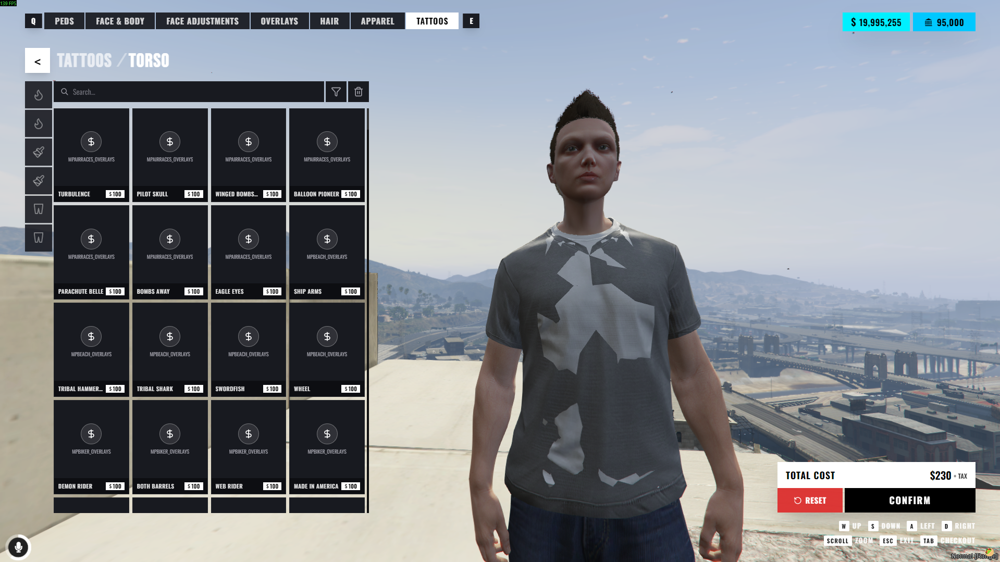

# Leonida-Appearance

`illenium-appearance` as it runs on our server: iLLeniumStudios' clothing and player customization resource in
Haaasib's redesign (below), with one addition of our own.

## Rack try-on

Inside the three vanilla clothing-store interiors, the racks themselves are targets. Look at a rack of shirts, jeans,
shoes, hats, glasses, bags or ties and browse it: the camera turns to your character wearing an item of that rack's
kind, with its name, price and colours on screen.

| Key | What it does |
|---|---|
| **Left** / **Right** | the previous / next item |
| **Up** / **Down** | its colours |
| **Enter** | buy and wear it |
| **Backspace** / **Esc** | leave (an item you did not buy goes back to what you wore) |

- The full menu at the store's clerk is unchanged; the racks are an extra way in.
- Where the racks are comes from the game's own interiors (`shared/racks.lua`, generated: 244 racks in 14 stores; a
  store in a custom interior gets none). Prices, cameras and keys are `Config.Racks` in `shared/config.lua`; a spot
  that is off in game can be fixed there (`extra` / `override`), and with `Config.Debug` on `/rackspot <category>`
  prints an entry for where you are aiming.
- The price is the server's (per category, plus `Config.TaxRate`), paid in cash, then from the bank.
- **With `vice_hud`** the try-on is drawn by the HUD itself: its shop panel (`ShowShopItem`: store and category,
  price, item, a swatch for each colour, "Not enough money"), its action prompts and its feed - and the only
  money on the screen is the HUD's own wallet, which shows the new total when you buy. Without it (or with
  `Config.Racks.hud = "own"`) the resource's own overlay draws the same thing, and shows your cash itself only
  when no `vice_hud` is there to show it.
- Not seen in game yet: the rack positions and the camera were worked out from the game's files.

Keep the resource's folder named `illenium-appearance`: other resources call its exports by that name.

---

# 🌟 NoPixel Inspired Clothing (`illenium-appearance`)

Modern FiveM clothing & player customization menu inspired by **NoPixel**.  
Redesign by **Haaasib**. Full credit to **iLLeniumStudios** for the base `illenium-appearance` script!

---

## 📸 Previews










---

## ⚡ Quick Install & Customization

1. Place `illenium-appearance` into your resources directory.
2. Add to your `server.cfg`:
```cfg
ensure oxmysql
ensure qbx_core # or qb-core / es_extended
ensure illenium-appearance
```
3. Restart server. (Database tables are automatically created on startup).

> 🎨 **UI Customization**: Full source code is included under the `/web` folder (React + TypeScript + TailwindCSS). Feel free to edit, rebuild (`npm run build`), and customize the UI however you like!

---

## 💬 Links & Support

- 💬 **Discord Support**: [https://discord.gg/kj3bWdD7uK](https://discord.gg/kj3bWdD7uK)
- 🛒 **Store**: [https://tebex.haaasib.dev/](https://tebex.haaasib.dev/)
- 📦 **GitHub Repository**: [https://github.com/Haaasib/illenium-appearance](https://github.com/Haaasib/illenium-appearance)
- 📦 **Base Script**: [iLLeniumStudios Base](https://github.com/iLLeniumStudios/illenium-appearance)