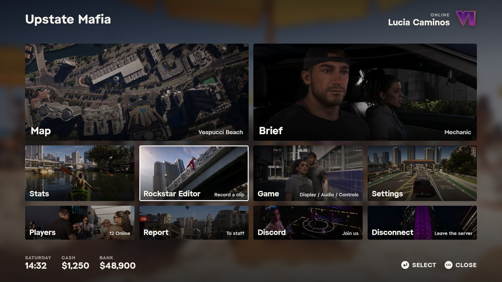
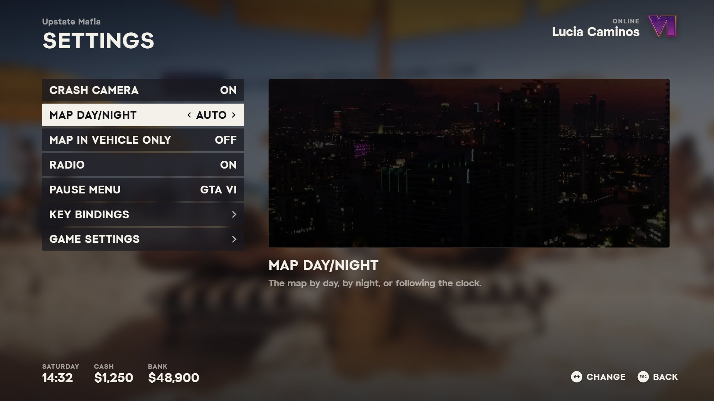
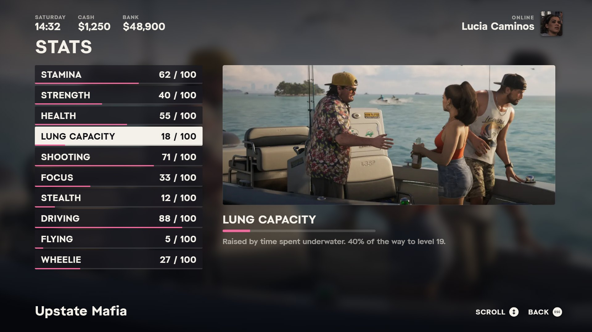
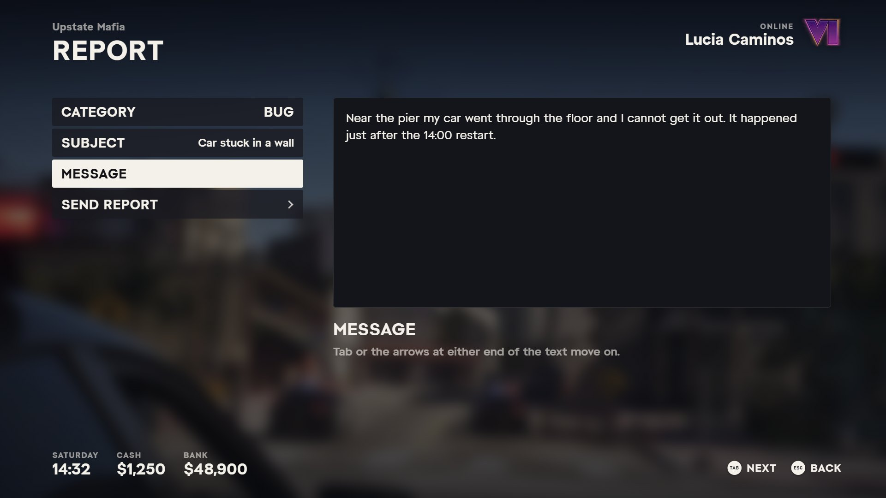
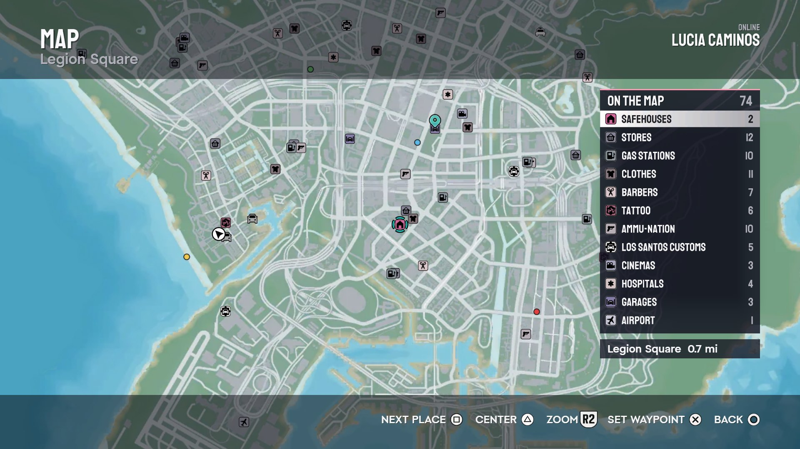

# vi_pausemenu

The pause menu as GTA VI's. ESC, P or a pad's Start opens a grid of picture tiles over the blurred game, the way
GTA VI's own pause menu looks: the day and time, the cash and the bank at the top left; the mode, the character's name
and the character's face at the top right; the server's name at the bottom left and the keys, each word then its key,
at the bottom right.



| Tile | What it does |
| --- | --- |
| Map | Single player's pause map (FBICat's GTA6Hud): the blips, the waypoint, a legend of places; below |
| Brief | Name, job and grade, duty, cash, bank, hunger, thirst, citizen ID, server ID |
| Stats | vice_hud's skills, each 0..100, with how far to the next level (needs `vice_hud`) |
| Rockstar Editor | Records a clip (the menu closes); while recording, choosing it again saves the clip |
| Game | The game's own settings (display, graphics, audio, controls) |
| Settings | This server's settings, below |
| Players | Everyone on the server, by server ID |
| Report | A category, a subject and a message to staff (a Discord webhook, or the server console) |
| Discord | Opens `Config.Discord` in the player's browser; no tile when it is empty |
| Disconnect | Asks first, then leaves the server |

Settings, Brief, Stats, Players and Report are GTA VI's settings screen: a list on the left, a picture and a line
about the chosen row on the right.

| | |
| --- | --- |
|  |  |
|  |  |

(Pictured in the browser preview, `tools/serve.py`, over a blurred still standing in for the game; the map with the
preview's own blips.)

## The character's face

A transparent pedheadshot of the player's own ped, taken each time the menu opens, on a portrait card like the
character switcher's (`qbx_relog`) and the honor panel's. The game has one slot for these pictures, so the slot is
borrowed, never held: the page copies the picture out of `nui-img` and the slot is let go at once (after five seconds
at most, whatever happens). The character's initials show until the picture comes, or if the game refuses one.

## Install

```
ensure vi_pausemenu
```

No dependency. With `qbx_core` it shows the character's name, money and brief; each setting row and the Stats tile
appear only while the resource they belong to is running.

## Keys

Arrows (or WASD) move, Enter chooses, left/right change a setting, Esc or Backspace goes back and at home closes, P
closes, the right mouse button goes back. The mouse works throughout. In the report's subject and message, Tab moves
on. A pad: the D-pad or the left stick moves, cross chooses, circle goes back, Start closes. The map has its own keys,
below.

## The map

The Map tile opens single player's pause map, the one in FBICat's GTA6Hud, on this page (the game's own map no longer
opens from this menu): its tiles over the sea, the blips the big map shows (up to 300 on screen, a plain dot in its
own colour), the waypoint pulsing over its place, the player's arrow, dark bars above and below, MAP and the area under
the cursor at the top left, the mode line and the character's name at the top right, the keys along the bottom, and
the legend on the right: the kinds of place on the map, with how many of each.

| | Keyboard and mouse | Pad |
| --- | --- | --- |
| Pan | Drag, arrows or WASD | Left stick |
| Zoom | Wheel, Page Up / Page Down | RT / LT |
| Set / remove the waypoint | Click (on the waypoint: off), Enter | Cross, at the ring in the middle |
| Back on the player | C | Triangle |
| The legend's kinds | E / Q, or click a row | RB / LB |
| The kind's next place | Delete, or click the row again | Square |
| Take the waypoint off | Delete (no kind chosen) | Square (no kind chosen) |
| Back to the tiles | Esc, Backspace, right click | Circle |
| Close the menu | P | Start |

A kind from the legend goes to its nearest place, ringed, zoomed in at least to street level, with the area's name and
the distance under the legend; again on the same kind, the next nearest. The client sends the player and the waypoint
ten times a second and the blips every 0.4 s while the map is up, scanned as single player scans them; it sets the
waypoint (`SetNewWaypoint`) and names the area under the cursor.

The map's art (its tiles, its blip, key and button icons, the Staatliches sprite font it writes with) and its design
are FBICat's, from his GTA6Hud for single player, converted from its `vipause` and `vifont` texture dictionaries into
`html/img/map`; `client/mapsprites.lua` lists the blip sprites it has pictures for. Thank you, FBICat.

## Settings

Each row reads and writes the resource it belongs to, so `/hudminimap`, `/mapmode` and the menu agree.

| Row | Resource | Through |
| --- | --- | --- |
| Crash Camera | `vi_crashcam` | `SetCrashCamEnabled`; remembered here (KVP `vi_pausemenu:crashcam`) and set again whenever vi_crashcam starts |
| Map Day/Night | `gen7_map` | `GetMapMode` / `SetMapMode` (auto, day, night); a map resource not in this bundle |
| Map in Vehicle Only | `vice_hud` | `GetMinimapOnFoot` / `SetMinimapOnFoot` |
| Radio | `vi_radio` | `IsMuted` / `SetMuted` |
| Pause Menu | here | GTA VI or Classic (the game's own); `/pausemenu` switches back |
| Key Bindings | the game | its key mapping screen (this server's actions) |
| Game Settings | the game | its settings screen |

## Config

`shared/config.lua`: the title (empty, the default: server.cfg's `sv_projectName`, else `sv_hostname`, sent by the
server with the players list), the mode line, the Discord invite, the report webhook and categories, the skills the
Stats screen lists (id, label, what raises it, its picture) and the tiles (which, in which row, their pictures and the
line at their right; `$location`, `$job`, `$players` and `$recording` are filled in).

## How it takes over the game's menu

As `gk_pausemenu` (in this bundle) does, so run one of the two, not both: the game's menu is kept shut with `SetPauseMenuActive(false)` every frame, and the key
is caught as a control press (`IsControlJustPressed` 199/200), not by watching the pause flag. The game's settings and
key bindings are the game's own screens (`ActivateFrontendMenu`), entered with the page's NUI focus dropped first and
the pause flag raised; when the player backs out (`IsFrontendReadyForControl` goes false) the page takes focus again
and shows the screen it was on. The map stays on the page, with its focus.

A UI that disables control 200 while it is up (the ATM, the phone's games, the casino) keeps this menu shut too.
`LocalPlayer.state.pauseMenuOpen` is true while it is up; vice_hud hides its minimap frame then.

## Pictures and type

In game the menu sits over the live game, blurred by the game's own screen blur; nothing is drawn behind it but a
dark tint. The tile and setting pictures (`html/img`) are stills from Rockstar's GTA VI footage. The type is
GTA Art Deco throughout, the same three cuts vice_hud ships (`html/fonts`): bold for titles, labels and values, medium
for the lines under them, regular for typed text. The map writes as single player's does: Staatliches (from its
sprite sheet, `html/img/map/font.webp`) for MAP, the names and the legend, Art Deco Medium for the rest.

## tools

- `node tools/run.js` — the client and server on a small FiveM (`tools/mock.lua`, `tools/check.lua`): opening and
  closing, the reopen cooldown, the tiles, every settings row against its export, the brief, stats and players, the
  map's data (blips as single player scans them), waypoint and area names, a pad on the menu and on the map, the
  settings hand-offs, the face's headshot slot, the editor, reports (rate limit, webhook), disconnect, classic mode.
  Uses vice_hud's fengari (`npm i jsdom fengari` in `vice_hud`, as its README says).
- `python tools/mutate.py` — breaks the code in 38 ways; each must make the checks fail.
- `python tools/serve.py` — the page in a browser with `tools/stub.js` standing in for the client
  (`?screen=settings|brief|stats|players|report`; `?map=1` the map, `&pad=1` with a pad, `&h=` the player's heading).
- `python tools/shots.py` — the pictures in `docs/`, from `serve.py`'s page (Python Playwright).

Not yet seen in game: the map, checked only in the browser preview and on the mock; a pad's sticks and triggers on it
especially.
